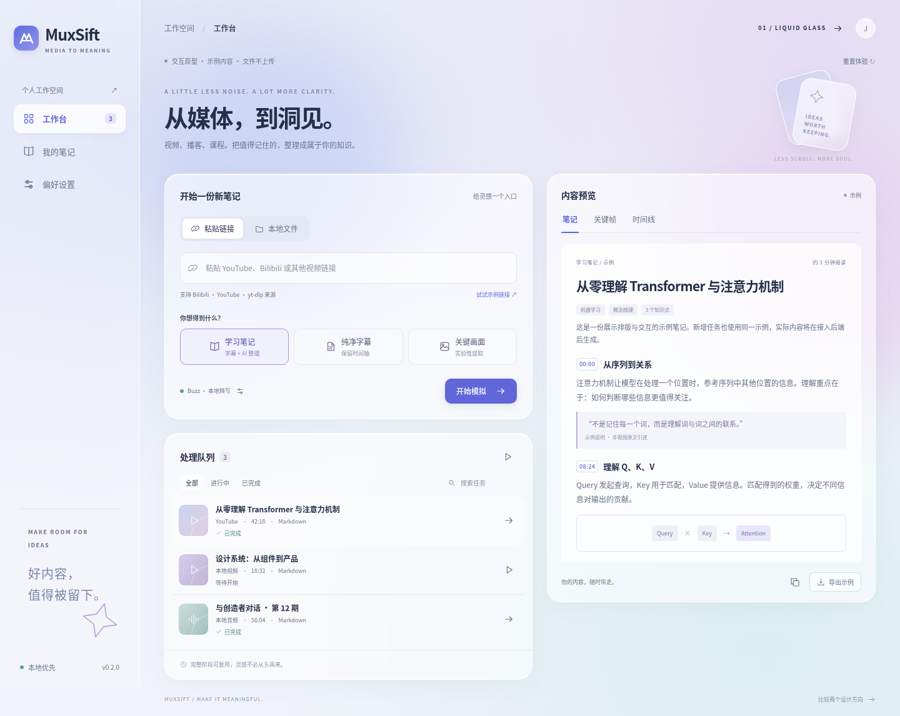
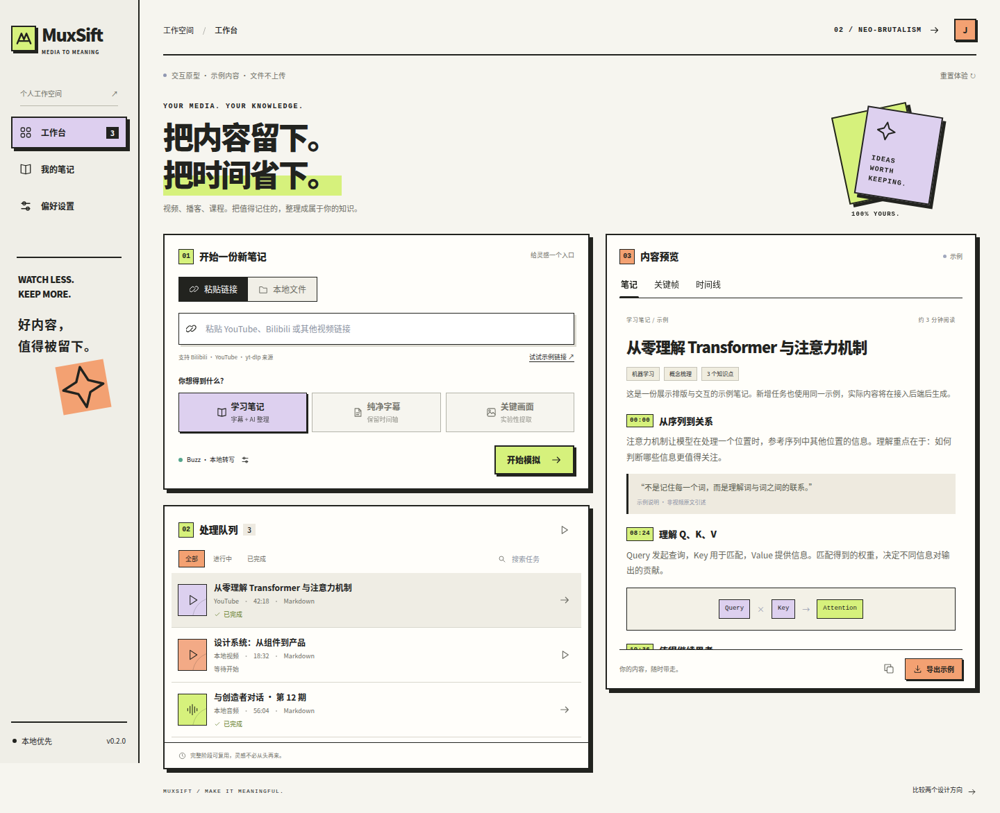

# MuxSift GUI candidates

两套可独立打开的浏览器交互原型，比较入口为 `index.html`：

- `liquid-glass.html`：半透明面板、蓝紫光晕、柔和层次，侧重阅读体验。
- `neo-brutalism.html`：粗边框、硬阴影、醒目色块，侧重明确的操作层级。

| Liquid Glass | Neo-brutalism |
| --- | --- |
|  |  |

无需安装前端依赖。直接用浏览器打开 HTML，或在仓库根目录运行：

```bash
python3 -m http.server 8765 --bind 127.0.0.1 --directory prototypes/gui
# 浏览器打开 http://127.0.0.1:8765
```

## 可体验流程

1. 点击“试试示例链接”，选择输出类型，然后“开始模拟”。
2. 切换“本地文件”，选择多个音视频/SRT 文件或文件夹，也可拖放文件。
3. 选择队列任务，暂停、继续或取消模拟；任务完成后查看示例结果。
4. 搜索任务，切换“我的笔记”，查看关键帧示意图和章节时间线。
5. 在偏好设置中切换 Buzz/Bcut、模型和默认输出。偏好保存在当前浏览器，两个主题分别存储。
6. 导出对应的示例 Markdown、SRT 或关键帧 JSON。切换设置主题不会调用任何云服务。

## 原型边界

任务以计时器模拟进度，所有结果都是明确标记的示例；不会上传、读取媒体内容或启动 FFmpeg、yt-dlp、ASR、AI。文件夹选择需要浏览器支持 `webkitdirectory`；复制依赖剪贴板权限，文件导出始终可用。设置不包含真实 API key。页面刷新会重置任务列表，偏好设置保留。

`app.js` 共享交互，`styles.css` 定义两种材质、间距、字号与响应式布局，`previews/` 保存实际浏览器截图。CSS/JS 无外部 CDN 或构建依赖。

## 后续接入

选定视觉方向后，可在 Tauri 中接入 `muxsift-core`：将任务创建映射到本地／网页工作流，以事件替换模拟进度，接收真实工件路径与错误状态。后台执行、原生文件夹选择、凭据管理与恢复检查点需要正式实现；此 demo 不假装已具备这些能力。

验证记录见 `QA.md`。
